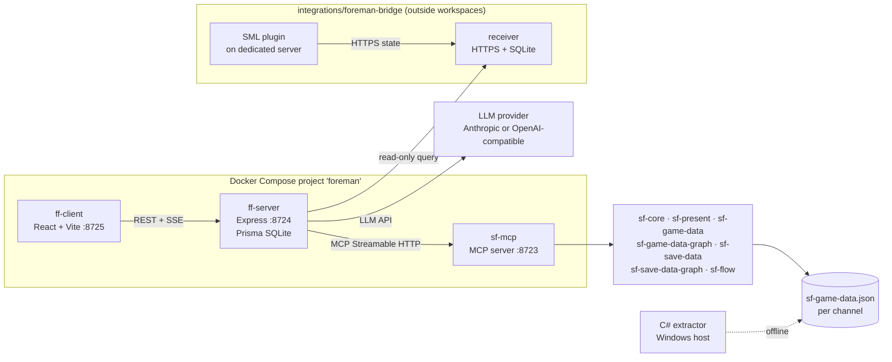

# Gaffer for Satisfactory — project record

<!-- Managed by Mainspring. GitHub Issues and the GitHub Project are authoritative for
     status, priority, dependencies, and PR links; this record does not copy them.
     Never paste access keys or other sensitive values here. -->

- Repository: https://github.com/max-is-loud/ficsit-gaffer
- GitHub Project (tracking): https://github.com/users/max-is-loud/projects/4
- Decisions and approvals: [`docs/execution/orchestration-log.md`](../execution/orchestration-log.md)

Each claim below has a source tag, for example [S1]. The "Sources" section gives the file and the line for each tag.

## Outcome

Gaffer is an AI companion web app for *Satisfactory*. It acts as the player's on-site foreman [S1]. It answers game questions from real game data, issues structured work orders, and gives the player a human-scaled next step [S1] [S2]. The goal is to keep the player in the game, not to play the game for the player [S2].

Gaffer derives from FICSIT Foreman (Apache-2.0) [S3]. Gaffer adds near-real-time awareness of the game world through a server-side SML bridge [S4]. The bridge tells what the player built, where the pioneer is, and whether the player met the work orders [S4].

## Constraints

| Constraint | Source |
| --- | --- |
| Gaffer is a separate project. Agents never write to the upstream repository or its tracker. The `upstream` git remote is read-only. | [S5] [S6] |
| Generally useful fixes go in self-contained commits, so that they stay upstreamable. | [S5] [S6] |
| The code, the packages and the images keep the `foreman` names until the rename in #15. | [S3] |
| The licence is Apache-2.0. `NOTICE` holds the upstream attribution. | [S7] |
| The conventions live in `CONTRIBUTING.md`: Conventional Commits with a body, prefixed branches, no commit to `main`, squash merges, British English. | [S8] |
| The code standards are enforced by `npm run lint` and `npm run check:source`. Two ratchet files (`source-limits.json`, `eslint-suppressions.json`) can only shrink. | [S9] [S10] |
| Raw game data (`en-US.json`, `game-data/`) and save files (`*.sav`) are never committed. | [S11] |
| Gaffer publishes no Docker images during development. Compose and CI build the images locally only. | [S12] [S13] |
| Node.js 22 or later and npm 11 or later for the workspaces. The bridge receiver needs Node.js 24.21.0 or later. | [S14] [S15] |
| The C# extractor, the map renderer and the Unreal bridge plugin build only on the Windows host, with a game install. | [S16] [S17] [S18] |
| The `main protection` ruleset requires a pull request and the `build-test` check. It allows squash merges only, blocks force pushes and branch deletion, and has no bypass actors. It requires no approving review and no up-to-date branch. Head branches are deleted after a merge. | [S19] |
| Development happens on WSL2 on the Windows host. There is no Proxmox VM. | [S20] |
| Only the project orchestrator does GitHub writes and moves board items. | [S21] [S6] |

## Model routing

From `.mainspring/config.json` [S22]:

| Role | Provider | Model | Options |
| --- | --- | --- | --- |
| Orchestrator | `claudeAgent` | `claude-opus-5-5` | — |
| Implementation (substantial) | `claudeAgent` | `claude-opus-5-5` | — |
| Bounded implementation | `claudeAgent` | `claude-sonnet-5-5` | — |
| Review | `codex` | `gpt-6.1-sol` | `reasoningEffort: high`, runtime mode `auto` |
| Complex review | `codex` | `gpt-6-astra` | runtime mode `auto` |

## Verification commands

The `verification` list in `.mainspring/config.json` [S22]. Each command passed at the base commit `e8a76b7` (see [`intake-report.md`](./intake-report.md)).

1. `npm ci --prefer-offline --no-audit --no-fund`
2. `npm run build`
3. `npm run lint`
4. `npm run check:source`
5. `npm test`
6. `cd integrations/foreman-bridge/receiver && npm test`

The CI job `build-test` runs commands 1 to 5 on Node.js 22 [S23]. The workflow `foreman-bridge.yml` runs command 6 on Node.js 24.21.0 [S24]. On Node.js 24 or later, `npm test` also runs the bridge end-to-end test, which CI skips on Node.js 22 [S25].

## Architecture

Gaffer is a monorepo of npm workspaces under `packages/` [S14]. Three services run in one Docker Compose project named `foreman` [S12]:

- `sf-mcp` is the unified MCP server on port 8723. It serves the game-data tools and the save-game tools from one endpoint [S26] [S12].
- `ff-server` is the Express backend on port 8724. It is the LLM proxy (Anthropic or OpenAI-compatible) with SSE streaming. It keeps the playthroughs and the work orders in Prisma (SQLite, Postgres later), and it is the MCP gateway to `sf-mcp` [S26] [S27].
- `ff-client` is the React and Vite web UI on port 8725 [S26] [S12].

`sf-mcp` uses six workspace libraries: `sf-flow`, `sf-game-data`, `sf-game-data-graph`, `sf-present`, `sf-save-data` and `sf-save-data-graph`. `sf-game-data` uses `sf-core` [S35]. The `sf-*` libraries carry no native dependency [S28] [S36].

The production graph is an in-memory adjacency projection, not a database [S29]. The game data is one merged `sf-game-data.json` for each release channel. The offline C# extractor makes it from the game install; the runtime loads the bundled file or `SF_GAME_DATA_PATH` [S30] [S31]. Work orders are application state in `ff-server`, not in an MCP server [S32].

The live-world part is the foreman bridge in `integrations/foreman-bridge/`. It is outside the npm workspaces [S33]. A server-only SML plugin reports Constructor placement and removal to an independent HTTPS and SQLite receiver. `ff-server` reads the receiver state through an authenticated, read-only query, for one linked playthrough [S33] [S34]. The receiver is the only store of live state [S34].

The offline tools are the game-data extractor (`packages/sf-game-data/extract/`) and the base-map renderer (`tools/sf-map-renderer/`). Both are .NET 10 and run on the Windows host [S16] [S17].

`AGENTS.md` › Status lists these shipped capabilities [S28]. Some design documents also record the shipped status [S36]. For Work Orders v2 and explore orders, the intake found the shipped status only in `AGENTS.md`: their documents give the design status. The intake proposes to remove that section, so this record keeps the list:

| Capability | Upstream reference | Shipped status also in |
| --- | --- | --- |
| Work Orders v2 | — | — (`docs/work-orders.md:3` calls it the canonical design) |
| Single-producer game-data pipeline: the C# extractor makes one merged `sf-game-data.json` per channel; the raw `en-US.json` is not committed | [upstream #164](https://github.com/StuartMeeks/ficsit-foreman/issues/164) | `docs/sf-game-data-extractor.md:3` |
| Explore orders: a second work-order type for collection routes, with save re-upload reconciliation | [upstream #207](https://github.com/StuartMeeks/ficsit-foreman/issues/207), [upstream #209](https://github.com/StuartMeeks/ficsit-foreman/issues/209) | — (`docs/explore-orders.md:3` calls it the agreed design) |
| Ingest-time verification: each plan reference is resolved or rejected, with power and recipe quantity checks | [upstream #222](https://github.com/StuartMeeks/ficsit-foreman/issues/222), [upstream #223](https://github.com/StuartMeeks/ficsit-foreman/issues/223) | `docs/work-order-quantity-verification.md:3-4` (for upstream #223 and upstream #228) |
| Flow solver (`sf-flow`, `find_bottlenecks`) | [upstream #148](https://github.com/StuartMeeks/ficsit-foreman/issues/148), [upstream #126](https://github.com/StuartMeeks/ficsit-foreman/issues/126) | `docs/flow-solver.md:3` |
| The game-data graph dropped Kùzu for an in-memory adjacency projection; no `sf-*` package has a native dependency | [upstream #243](https://github.com/StuartMeeks/ficsit-foreman/issues/243) | `docs/component-architecture.md:201-204` |

## Sources

| Tag | Claim | File and line |
| --- | --- | --- |
| S1 | Product summary: foreman, work orders, real game data | `AGENTS.md:3-5`; `README.md:11-15` |
| S2 | Vision: human-scaled next step; keep the player playing | `docs/product.md:27-31` |
| S3 | Derivative of FICSIT Foreman; `foreman` names until #15 | `AGENTS.md:7-10`; `README.md:5-9` |
| S4 | Live-world awareness through the SML bridge | `README.md:220-224` |
| S5 | Upstream is read-only; upstreamable commits | `CONTRIBUTING.md:177-186` |
| S6 | Agent rules for Gaffer; orchestrator owns the board | `AGENTS.md:103-129` |
| S7 | Apache-2.0 licence and `NOTICE` | `README.md:201-204` |
| S8 | Commit, branch, PR and language conventions | `CONTRIBUTING.md:11-38`; `CONTRIBUTING.md:118` |
| S9 | Code standards and enforcement | `CONTRIBUTING.md:86-175` |
| S10 | Ratchet rules for agents | `AGENTS.md:96-101` |
| S11 | Game data and saves are gitignored | `.gitignore:1-9` |
| S12 | Compose project `foreman`; local builds; ports | `compose.yaml:19-21`; `compose.yaml:37`; `compose.yaml:77`; `compose.yaml:136-137` |
| S13 | Image workflows build without a push | `.github/workflows/docker-publish-ff-client.yml:8-11`; `.github/workflows/docker-publish-ff-client.yml:102` |
| S14 | Workspaces; Node.js and npm engines | `package.json:9-15` |
| S15 | Receiver needs Node.js 24.21.0 or later | `integrations/foreman-bridge/receiver/package.json:6-8` |
| S16 | Map renderer: Windows host, .NET 10 | `tools/sf-map-renderer/README.md:14-17`; `tools/sf-map-renderer/Directory.Build.props:11` |
| S17 | Extractor: host-only; .NET 10 | `packages/sf-game-data/extract/README.md:29-31`; `packages/sf-game-data/extract/sf-game-data-extractor/sf-game-data-extractor.csproj:10` |
| S18 | Bridge plugin needs the custom Unreal engine and a Windows toolchain | `integrations/foreman-bridge/README.md:36-39` |
| S19 | `main protection` ruleset and merge settings | Orchestrator brief for #66, checked on 28 Oct 2026 (not in the repository) |
| S20 | Development on WSL2 | User decision of 28 Oct 2026, in the orchestrator brief for #66 (not in the repository) |
| S21 | The orchestrator does all GitHub writes | `agents/orchestrator.md:10`; `agents/worker.md:22` |
| S22 | Routing and verification configuration | `.mainspring/config.json:18-52` |
| S23 | CI job `build-test` | `.github/workflows/ci.yml:16-48` |
| S24 | Bridge receiver CI job | `.github/workflows/foreman-bridge.yml:24-38` |
| S25 | End-to-end bridge test skips below Node.js 24 | `packages/ff-server/test/bridge-integration.test.ts:28`; `packages/ff-server/test/bridge-integration.test.ts:56`; `.github/workflows/foreman-bridge.yml:40-41` |
| S26 | Package roles | `AGENTS.md:21-35`; `README.md:27-31` |
| S27 | Services diagram and key decisions | `docs/architecture.md:20-48`; `docs/architecture.md:52-61` |
| S28 | Shipped capabilities; no native dependency in `sf-*` | `AGENTS.md:60-71` |
| S29 | In-memory production graph | `docs/architecture.md:101-115` |
| S30 | Merged dataset per channel; extractor | `CONTRIBUTING.md:202-220` |
| S31 | Game-data resolution order | `README.md:187-189` |
| S32 | Work orders live in `ff-server` | `docs/architecture.md:127-132` |
| S33 | Bridge plugin, receiver, outside workspaces | `integrations/foreman-bridge/README.md:3-14` |
| S34 | Live query path; receiver is the only live store | `docs/live-constructor-awareness.md:3-21` |
| S35 | Workspace libraries that `sf-mcp` and `sf-game-data` use (the diagram's library box) | `packages/sf-mcp/package.json:27-32`; `packages/sf-game-data/package.json:17` |
| S36 | Shipped status in design documents; no native dependency | `docs/sf-game-data-extractor.md:3`; `docs/work-order-quantity-verification.md:3-4`; `docs/flow-solver.md:3`; `docs/component-architecture.md:201-204` |

## Open questions

1. The intake did not build or test the C# extractor (`packages/sf-game-data/extract/`), the map renderer (`tools/sf-map-renderer/`) or the Unreal bridge plugin (`integrations/foreman-bridge/mod/`). They need the Windows host, a game install, or the custom Unreal engine, and this WSL2 environment has no `dotnet`. Which agent or machine verifies a change to these parts?
2. `sf-game-data-parse` says that it builds anywhere (`packages/sf-game-data/extract/sf-game-data-parse/sf-game-data-parse.csproj:5-6`). Does the user want .NET 10 on WSL2, so that agents can build it and so that #30 (`dotnet format`) can run locally?
3. The intake did not build the three Docker images, because this environment has no `docker`. CI builds them on a path filter. Is a local image build part of the verification of a change to a `Dockerfile`?
4. The bridge source-manifest check (`node ../scripts/update-source-manifest.mjs --check`) fails at the base commit: `mod/.clang-format` (added in `67099d2`, #32) is not in `source-manifest.json`. Does the user want an issue to fix the manifest?
5. Can WSL2 read the game install, for example under `/mnt/c`? `AGENTS.md:159-160` says that the game files are not accessible. That statement was for the Proxmox VM.
6. Other files still name the old VM: `docs/advanced-game-settings.md:5`, `docs/advanced-game-settings.md:197`, `tools/sf-map-renderer/README.md:14`, and `sf-game-data-parse.csproj:5-6`. Are the save fixtures under `~/saves/` still present on WSL2?
7. The comment in `.github/workflows/dependabot-auto-merge.yml:15-26` says that this repository has no `main protection` ruleset. The ruleset now exists, requires only `build-test`, and requires no code-owner approval. Does the user want the comment and the `validate-game-data` check plan brought up to date?
8. The README says npm 10 or later (`README.md:113-114`; also `docs/architecture.md:139`), but `package.json:14` requires npm 11 or later. Which is correct?
9. The layout lists in `AGENTS.md:21-35` and `docs/architecture.md:62` omit `sf-flow` and `sf-save-data-graph`. Does the user want them in those lists?
10. The intake did not run `npm run measure:turn` (a paid model call), the `db:*` Prisma scripts, or `.github/scripts/check-game-data.mjs` (it compares two commits of a data PR).

## Active issue and session associations

Live execution is in T3; capacity and dispatch ownership are in the shared journal
(`mainspring status`). This table references them by identity only.

| Issue | T3 thread | Worktree | Commit |
| --- | --- | --- | --- |
| — | — | — | — |
